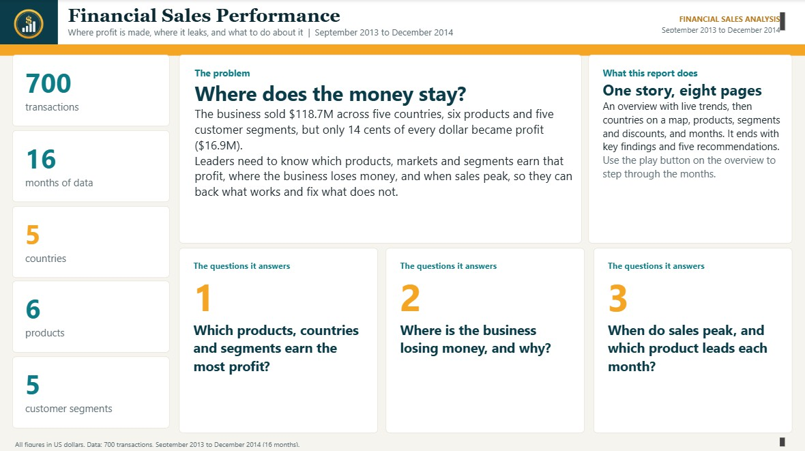
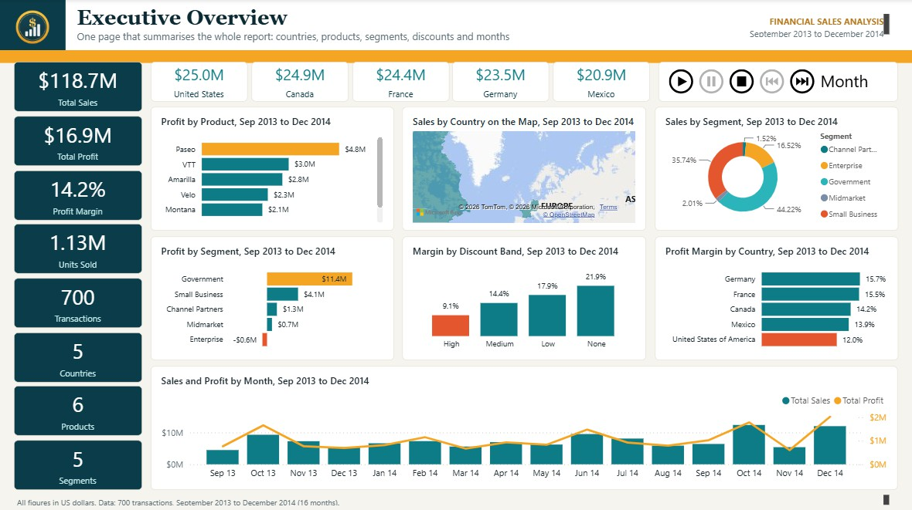
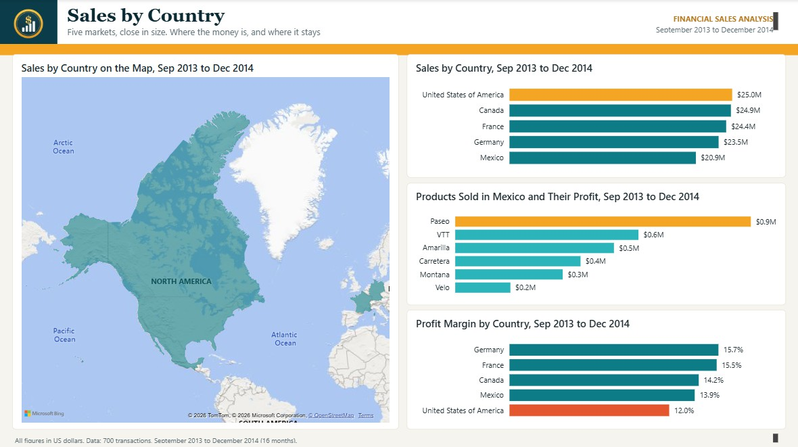
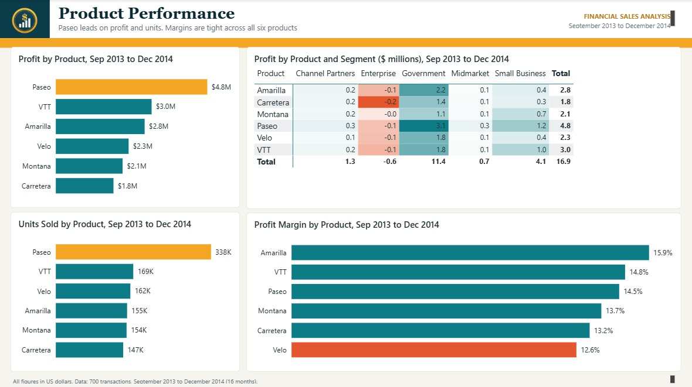
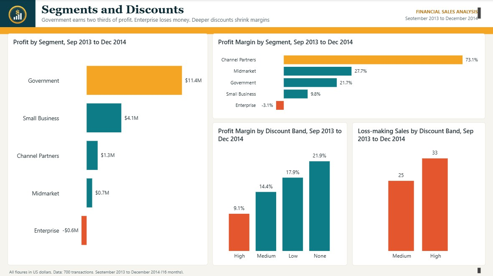
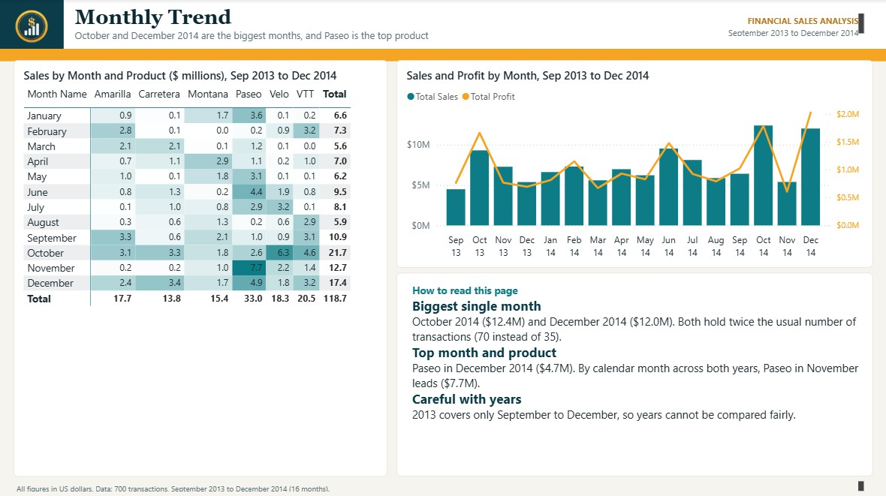
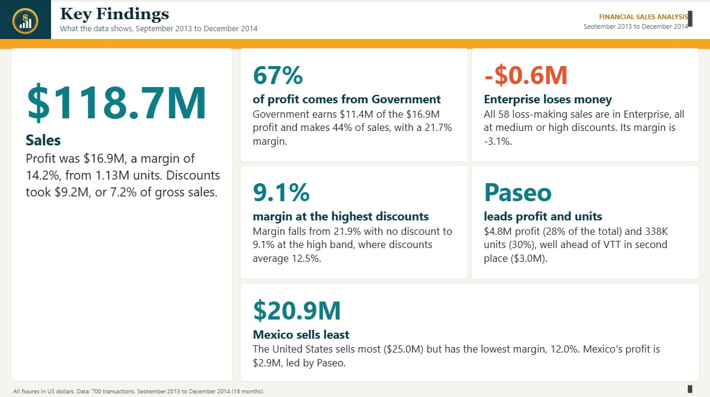
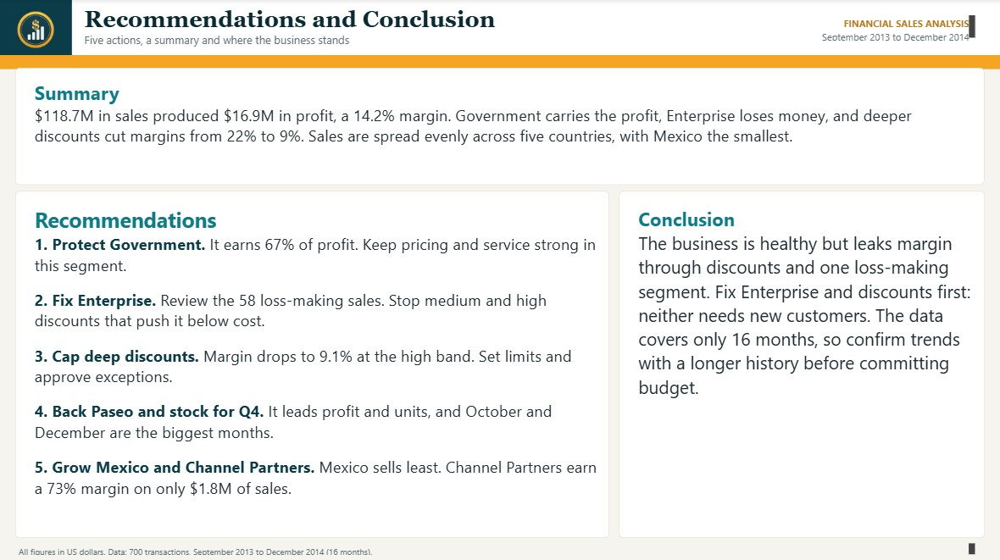

# Financial Sales Analysis

**Where does the money stay?**

A Power BI report on 700 sales transactions across five countries, six products and five customer segments, from September 2013 to December 2014. The business sold $118.7M but kept only 14 cents of each dollar as profit. This project shows where that profit is made, where it leaks, and what to do about it.


## Quick links

- 📊 [Power BI project](powerbi/Financial%20Dashboard.pbip) (open in Power BI Desktop)
- 📄 [Strategic brief (PDF)](docs/Financial-Sales-Strategic-Brief.pdf), which renders inline on GitHub
- 🎞️ [Presentation (PowerPoint)](docs/Financial-Sales-Presentation.pptx) with the speech in the slide notes
- 🎤 [Speech and likely questions](docs/Speech.md)
- 🗂️ [Dataset (Excel)](data/Financial_Sample_Data.xlsx)

---

> **A note on GitHub previews.** GitHub renders Markdown, PDFs and images inline. It does not preview PowerPoint files or Power BI projects in the browser. For those, GitHub shows a file page with a **Download** button on the top right. This is normal.

---

## Table of Contents

- [About the project](#about-the-project)
- [Headline findings](#headline-findings)
- [Report pages](#report-pages)
- [Repository structure](#repository-structure)
- [Data dictionary](#data-dictionary)
- [Run it locally](#run-it-locally)
- [Key insights](#key-insights)
- [Recommendations](#recommendations)
- [Tech stack](#tech-stack)
- [Limitations](#limitations)
- [License](#license)

---

## About the project

Leaders need to know three things: which products, markets and customer segments earn the profit, where the business loses money and why, and when sales peak. The report answers those in eight pages and ends with five recommendations.

The work covers the full BI cycle:

1. **Modelling** one sales table with derived columns for month, discount level and sort order
2. **Measuring** sales, profit, margin, discount rate and loss-making sales in DAX, with measures that also build every chart title
3. **Visualising** the results in an eight-page report with a Play Axis that steps through the months
4. **Presenting** the findings in an 11-slide deck, a strategic brief and a speech

The dataset has 700 transactions, 5 countries, 6 products, 5 segments and 4 discount bands, covering 16 months.

---

## Headline findings

| Metric | Value | Note |
|---|---|---|
| Sales | **$118.7M** | 700 transactions, 1.13M units |
| Profit | **$16.9M** | A margin of 14.2% |
| Government profit share | **67%** | $11.4M of the $16.9M |
| Enterprise profit | **-$0.6M** | On $19.6M of sales, a margin of -3.1% |
| Margin at a high discount | **9.1%** | Against 21.9% with no discount |
| Loss-making sales | **58** | All in Enterprise, all with a medium or high discount |
| Paseo profit share | **28%** | $4.8M, and 338,000 units |

---

## Report pages

Click any image to view full size.

### 1. Introduction

*The problem statement and the three questions the report answers.*



### 2. Executive overview

*Everything on one page: KPIs, countries, products, segments, discounts and months, with a Play Axis.*



### 3. Countries

*Five markets close in size. The United States sells the most and keeps the least.*



### 4. Products

*Paseo leads on profit and units. A heat map shows profit by product and segment.*



### 5. Segments and discounts

*Government earns two thirds of profit. Enterprise loses money. Deeper discounts shrink margins.*



### 6. Monthly trend

*Sales and profit by month, and sales by month and product.*



### 7. Key findings

*Five findings with the numbers behind them.*



### 8. Recommendations and conclusion

*Five recommendations, a summary and a conclusion.*



For the story behind each page, see [the strategic brief](docs/Financial-Sales-Strategic-Brief.pdf).

---

## Repository structure

```
financial-sales-analysis/
│
├── README.md                                  This file
├── LICENSE                                    MIT
├── CONTRIBUTING.md                            Contribution guidelines
├── .gitignore
│
├── data/
│   └── Financial_Sample_Data.xlsx             The 700-row source table
│
├── docs/
│   ├── Financial-Sales-Strategic-Brief.pdf    Renders inline on GitHub
│   ├── Financial-Sales-Presentation.pptx      11 slides, speech in the notes
│   ├── Speech.md                              The speech and likely questions
│   ├── logo.png
│   └── screenshots/                           Report page JPGs and hero image
│
└── powerbi/
    ├── Financial Dashboard.pbip               Open this in Power BI Desktop
    ├── Financial Dashboard.Report/            Pages and visuals as readable JSON
    └── Financial Dashboard.SemanticModel/     Tables, columns and measures as TMDL
```

---

## Data dictionary

The source is a single table of sales transactions.

| Column | Type | Description |
|---|---|---|
| `Segment` | Text | Government, Small Business, Channel Partners, Midmarket or Enterprise |
| `Country` | Text | Canada, France, Germany, Mexico or United States of America |
| `Product` | Text | Amarilla, Carretera, Montana, Paseo, Velo or VTT |
| `Discount Band` | Text | None, Low, Medium or High |
| `Units Sold` | Decimal | Units in the transaction |
| `Manufacturing Price` | Decimal | Cost to make one unit |
| `Sale Price` | Decimal | Price of one unit |
| `Gross Sales` | Decimal | Units sold times sale price |
| `Discounts` | Decimal | Value of the discount given |
| `Sales` | Decimal | Gross sales minus discounts |
| `COGS` | Decimal | Cost of goods sold |
| `Profit` | Decimal | Sales minus COGS |
| `Date` | Date | Transaction date |
| `Month Number`, `Month Name`, `Year` | Derived | Parts of the date |

The report adds measures such as Total Sales, Total Profit, Profit Margin, Discount Rate and Loss-making Sales, plus calculated columns for month label and discount level.

---

## Run it locally

1. Clone or download this repository.
2. Open `powerbi/Financial Dashboard.pbip` in Power BI Desktop (free from Microsoft).
3. The Play Axis visual comes from AppSource and installs the first time Power BI asks for it.
4. To refresh the data, choose Transform data and set the Excel source to `data/Financial_Sample_Data.xlsx`. The saved model still points to the original file path on another computer, but the data already in the report displays without a refresh.

---

## Key insights

1. **Government carries the business.** It earns $11.4M of the $16.9M profit, 67%, and makes 44% of sales.

2. **Enterprise loses money.** It sold $19.6M and lost $0.6M. All 58 loss-making sales in the data are Enterprise sales.

3. **Deep discounts are how it loses.** Margin falls from 21.9% with no discount to 17.9% at low, 14.4% at medium and 9.1% at high. Every loss-making sale carried a medium or high discount: 33 high and 25 medium.

4. **The biggest market keeps the least.** The United States sold $25.0M but earned a 12.0% margin, the lowest of the five. Germany earns the most at 15.7%.

5. **Paseo is the product that carries it.** It earned $4.8M, 28% of all profit, and sold twice the units of the next product. Margins across the six products range only from 12.6% to 15.9%.

6. **October and December are the peaks.** October 2014 was the biggest month for sales ($12.4M) and December 2014 for profit ($2.0M). Both had 70 transactions, double the usual 35.

---

## Recommendations

| Priority | Action | Expected impact |
|---|---|---|
| High | Protect Government pricing and service | Keeps the segment that earns 67% of profit |
| High | Fix Enterprise: review the 58 loss-making sales and stop the medium and high discounts that push them below cost | Turns a $0.6M loss into a profit without new customers |
| High | Cap deep discounts and approve exceptions | Stops margin falling to 9.1% at the high band |
| Medium | Back Paseo and stock for the fourth quarter | Meets the October and December peaks |
| Medium | Grow Mexico and Channel Partners | Mexico sells the least, and Channel Partners earn a 73% margin on only $1.8M |

Full discussion in [the strategic brief](docs/Financial-Sales-Strategic-Brief.pdf) and [the speech](docs/Speech.md).

---

## Tech stack

| Layer | Tool |
|---|---|
| Data preparation | Excel, Power Query |
| Modelling and measures | Power BI, DAX |
| Visualisation | Power BI Desktop, Play Axis custom visual |
| Documentation | PowerPoint, PDF |

---

## Limitations

- **The data is a sample.** It is Microsoft's "Financials" sample table, used here as a course exercise, so the findings show the analytical approach more than a real business.
- **Only 16 months.** 2013 covers September to December and 2014 covers all twelve months, so the two years are never compared as wholes, and a seasonal pattern can't be confirmed.
- **No reasons.** The data shows what happened, not why. It can't say why those 58 discounts were given.
- **Costs stop at COGS.** There are no overheads, so profit here is gross of running costs.

---

## License

Released under the MIT License. See [LICENSE](LICENSE).

---

**Built by Bih Brandy Sango** · Data Scientist and BI Analyst

- 📊 [Power BI project](powerbi/Financial%20Dashboard.pbip)
- 📄 [Strategic brief](docs/Financial-Sales-Strategic-Brief.pdf)
- 🎞️ [Presentation](docs/Financial-Sales-Presentation.pptx)
